#  ZawMongo

A lightweight MongoDB desktop client in the spirit of ZawSQL, written in C#.

The backend is an ASP.NET Core app that talks to the server through the official [MongoDB C# driver](https://www.mongodb.com/docs/drivers/csharp/). The UI is plain HTML/CSS/JS embedded in the executable, shown in a **native window** through [Photino](https://www.tryphotino.io) with the operating system's own web view: WebView2 on Windows, WKWebView on macOS and WebKitGTK on Linux. Its title bar follows the light or dark theme, and closing it quits the app. Where the web view isn't available, ZawMongo falls back to a chromeless app-mode window of an installed Chromium browser (Chrome, Edge, Chromium or Brave).

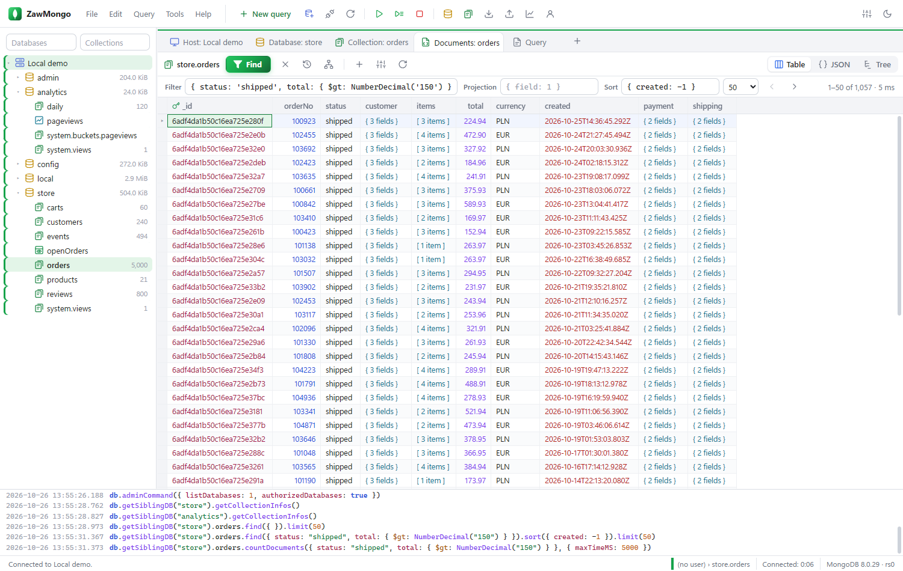

## Features

- **Session manager**: saved connections by host and port or by **connection string** (`mongodb://` and `mongodb+srv://`), user, password, auth database and mechanism (SCRAM-SHA-256/1, X.509, LDAP PLAIN), replica set name or direct connection, TLS (optionally accepting self-signed certificates), read preference, default database, database filter and connect timeout, plus a connection test.
  - Saved passwords are encrypted (AES-GCM) with a per-user key. A password typed inside a connection string is taken out of it and stored encrypted like any other; the string is saved without it.
- **SSH tunnels**: connect through an SSH server with a password or a private key (file path or pasted key, optionally with a passphrase). On first contact ZawMongo shows the host key fingerprint and asks you to trust it; a changed key is refused with a man-in-the-middle warning. A dropped tunnel is re-established on the same local port. Through a tunnel ZawMongo always uses a direct connection to the server behind it.
- **Session colors, production mark and read-only mode** (per session):
  - **Production server:** a PROD badge, a PRODUCTION status-bar marker and `[PRODUCTION]` in the window title; every change asks first (with "don't ask again until I reconnect").
  - **Read-only:** only reading commands run. Query tabs may use `find`, `aggregate` (without `$out` / `$merge`, also inside `$facet` and `$lookup` pipelines), counts, `distinct`, index listings, statistics, `explain`, `show …` and an allowlist of read-only database commands; inserts, updates, deletes, index and collection changes, user changes and `killOp` are refused by the backend, and the UI disables them.
  - **Every session:** updates and deletes with an empty filter (`deleteMany({})`) ask before running (can be switched off in Preferences).
- **Object tree**: sessions › databases (with size on disk) › collections, views and time series collections (with document counts). Filter boxes, keyboard navigation and context menus (open, aggregate, insert, export, import, rename, drop).
- **Documents tab**: a collection's documents with **filter**, **projection** and **sort** (shell syntax: `{ status: 'open', total: { $gt: NumberDecimal('100') } }`), page size and paging, the total count (exact with a 5 s limit for filtered queries, estimated otherwise) and timing. Filters are remembered per collection and the last 20 are offered again (Alt+↓).
  - **Three views:** a **table** of the top-level fields (nested documents and arrays summarised as `{ 3 fields }` / `[ 4 items ]`, columns can be rearranged and hidden, the layout is remembered per collection), **JSON** (pretty-printed shell syntax with highlighting), and an expandable **tree** with each field's type.
  - **Editing:** edit a field in place (strings stay strings; other types are read as shell syntax, so `42` stays a number and `ISODate("…")` a date), set it to null or remove it; edit the whole document in an editor; insert one or many documents; clone; delete one or a selection; copy as JSON; "filter by this value". Changes go out as `$set` / `$unset` / `replaceOne` by `_id`, and the `_id` can't be changed by accident.
  - **Exact types everywhere:** documents travel as canonical Extended JSON, so an `Int64`, `Decimal128`, `Double`, `Date`, UUID or binary value keeps its type through an edit — `NumberLong("9007199254740993")` survives a round trip.
  - **Update or delete matching documents** (`updateMany` / `deleteMany` over the current filter, with a count and confirmation), **export** the matching documents, **explain** the current find, or open it in a query tab.
- **Collection tab**:
  - **Indexes** with their keys, properties (unique, sparse, partial, TTL, hidden, text, geo, collation), size and **how often each was used** (`$indexStats`), with never-used indexes pointed out. Create indexes (keys, name, unique, sparse, hidden, TTL, partial filter) and drop them.
  - **Schema:** samples up to 10,000 random documents (optionally matching a filter) and lists every field, also inside arrays and nested documents, with its presence, its types and their share, array lengths and example values.
  - **Statistics** (count, data and storage size, compression ratio, free storage, index sizes, capped) and the raw `$collStats`.
  - **Validation:** view and edit the validator (`$jsonSchema` or a query expression), validation level and action (`collMod`).
  - **Options** the collection or view was created with.
- **Database tab**: every collection and view with documents, data size, storage, average document size, indexes and index size, notes (capped, time series, validation, view source); sortable; totals.
- **Query tabs** with a mongosh-style **shell**:
  - `use`, `show dbs|collections|users|roles|profile|log`, `db.<coll>.find(…).sort(…).skip(…).limit(…)`, `findOne`, `aggregate`, `countDocuments`, `estimatedDocumentCount`, `distinct`, `insertOne/Many`, `updateOne/Many`, `replaceOne`, `deleteOne/Many`, `findOneAndUpdate/Replace/Delete`, `createIndex(es)`, `dropIndex(es)`, `getIndexes`, `drop`, `renameCollection`, `stats`, `explain`, and database methods such as `runCommand`, `adminCommand`, `getCollectionNames`, `createCollection`, `createView`, `currentOp`, `killOp`, user management and profiling. Collections are reached by name, `db['name']`, `db.getCollection('name')` or on another database with `db.getSiblingDB('x')`.
  - Arguments are literal values in shell syntax — JSON with unquoted keys and single quotes, `ObjectId()`, `ISODate()`, `NumberLong()`, `NumberDecimal()`, `UUID()`, `Timestamp()`, `/regex/i`, comments — read exactly by the backend. JavaScript (variables, functions, loops) is deliberately not run.
  - Run everything (F9), the selection, or the statement at the caret (Ctrl+Enter); statements are split at semicolons and complete lines, and chained `.sort(…)` on the next line belongs to the statement. One result tab per statement, documents shown in the same table / JSON / tree views (editable when they are whole documents of one collection), values pretty-printed. Results stop at a chosen number of documents (and say so). Stop cancels the running statement. An error selects the failing statement in the editor.
  - Editor with highlighting, line numbers, auto-indent, bracket closing, line comments (Ctrl+/) and **autocompletion** of collection names after `db.`, collection and cursor methods, and query/update/aggregation operators after `$`.
  - **Saved queries** (Ctrl+S, with folders and descriptions; several windows can save at once without losing changes), **history** of what ran, load and save script files. Tabs are restored on the next start.
- **Visual explain** (Ctrl+Shift+E, or the Explain button in the Documents tab): runs `explain("executionStats")` and shows documents returned, keys and documents examined and time, findings such as **collection scans**, **in-memory sorts**, many documents examined per result, filters applied after FETCH and covered queries, the winning plan as a tree of stages (index, bounds, filter, per-stage counts), pipeline stages after the query, and the raw output. Works with the classic and slot-based (SBE) engines and with aggregations.
- **Host tab**:
  - **Databases** with sizes; create and drop databases.
  - **Monitor:** live tiles and charts refreshed every 1–10 s — operations per second by type, documents returned/inserted/updated/deleted, average read/write/command latency, network traffic, connections and queues, keys and documents scanned, WiredTiger cache use, resident memory and uptime. Not written to the log.
  - **Operations:** `currentOp` with namespace, running time, client, application, user, plan summary, lock waits and the command; refreshes every 2 s, filters by duration, shows idle and system operations on request, and **kills** selected operations (confirmed; not in read-only sessions).
  - **Users:** users of one or all databases with their roles and mechanisms; add users, change passwords, grant and revoke roles (built-in and user-defined, on any database) and drop users. Passwords never reach the log.
  - **Replica set:** members with state, health, lag behind the primary, ping, sync source, uptime, priority and votes, hidden and delayed members, a verdict, and the configuration.
  - **Server:** `serverStatus`, `buildInfo`, `hostInfo`, the command line and all parameters as an expandable tree.
- **Import and export:**
  - **Import** JSON arrays, NDJSON / mongoexport output (Extended JSON understood) and **CSV** (delimiter detected, quoted fields with line breaks, dotted headers such as `address.city` become nested fields, numbers, booleans and ISO dates typed while codes with leading zeros stay text) into a new or existing collection, with a preview. Existing `_id`s can be errors, replaced or skipped; optionally drop the collection first or stop at the first error. Batches of 1,000 documents; failures are reported with their document number.
  - **Export** a collection or the documents matching a filter as a JSON array, NDJSON or CSV (columns from the documents or a field list), in relaxed or canonical Extended JSON, streamed to a file.
- **Command log**: every command ZawMongo sends, written as runnable mongosh (`db.getSiblingDB("shop").orders.find({ … }).limit(50)`), with millisecond timestamps, highlighting of slow commands (threshold configurable), find and filter (errors, slow), open in a query tab, copy and save.
- **Dark mode**, interface zoom, updates from GitHub releases (checked against SHA-256 checksums, signed builds only accept updates from the same publisher) and "What's new" after an update — shared with ZawSQL.

## Screenshots

Session manager with a production session (PROD badge, SSH tunnel) and a read-only one:

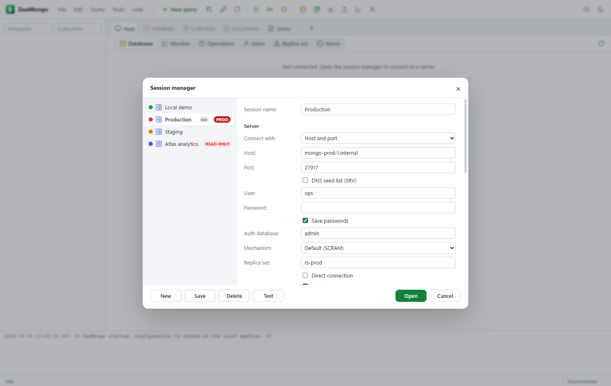

The documents of a collection as a tree with each field's type, and the document editor in shell syntax:

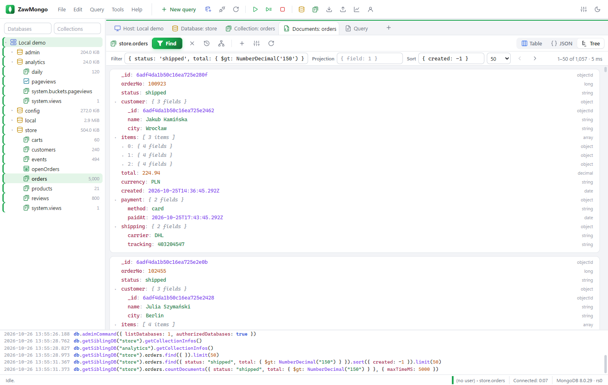

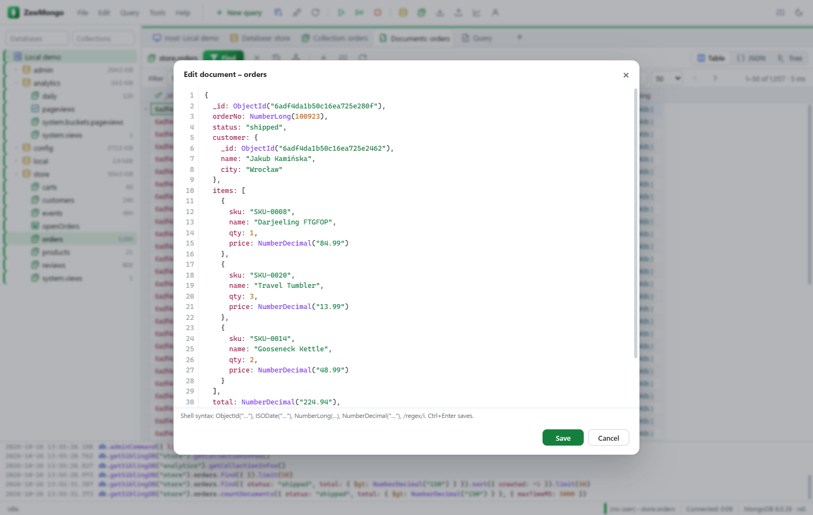

Indexes with their usage, and the schema of a sampled collection:

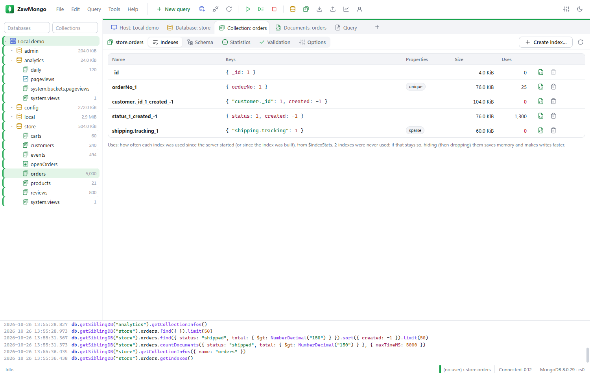

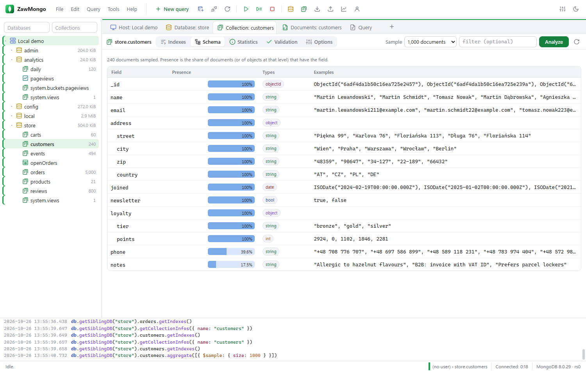

The collections of a database with their sizes:

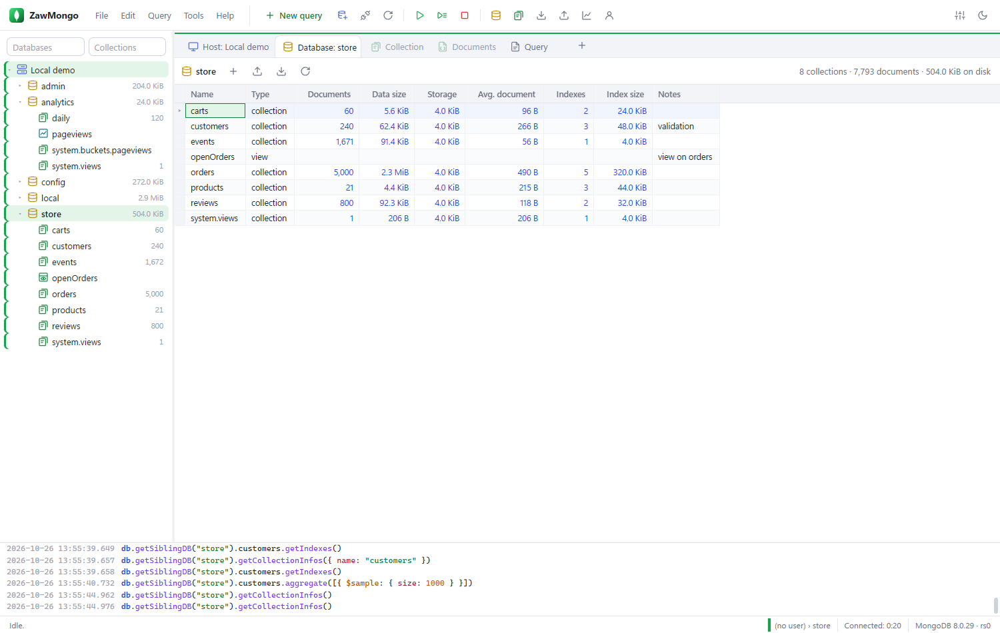

A query tab with an aggregation, and the saved queries:

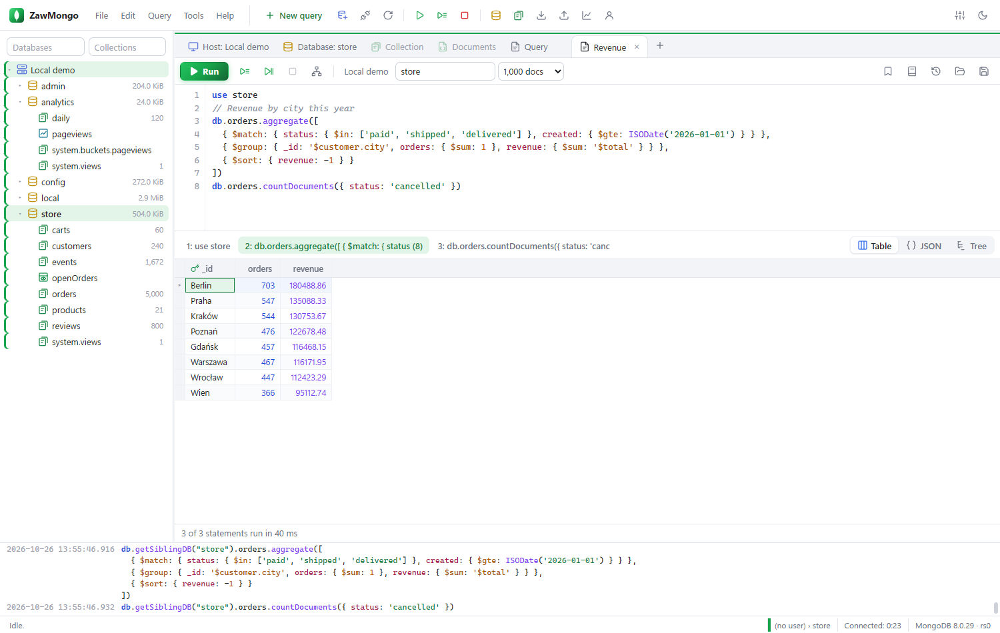

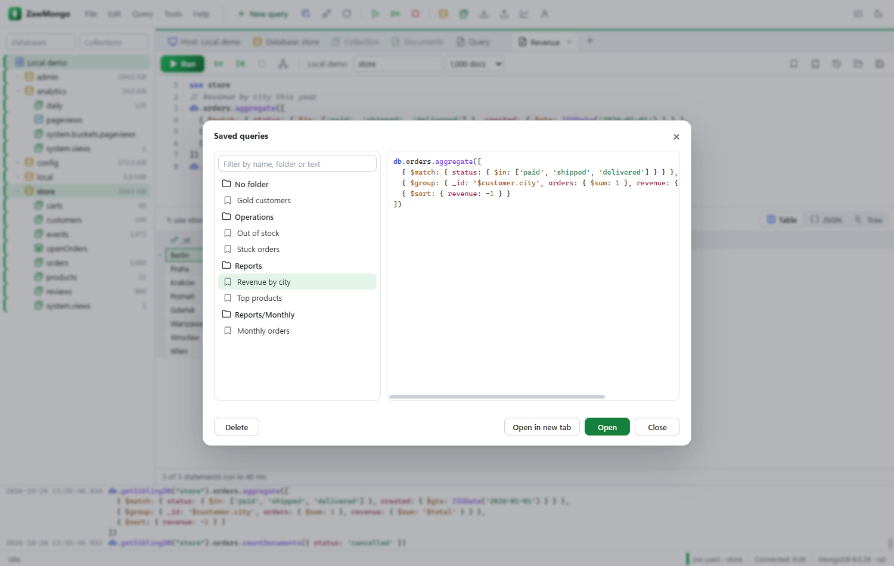

Visual explain of a find that scans the whole collection:

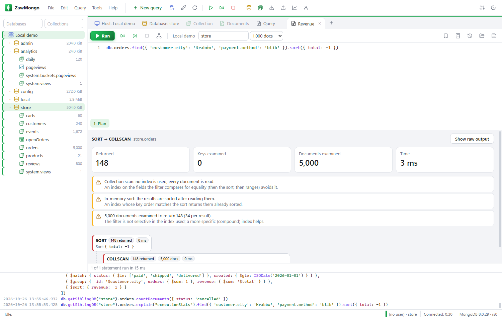

Server monitor, users, replica set and running operations (dark theme):

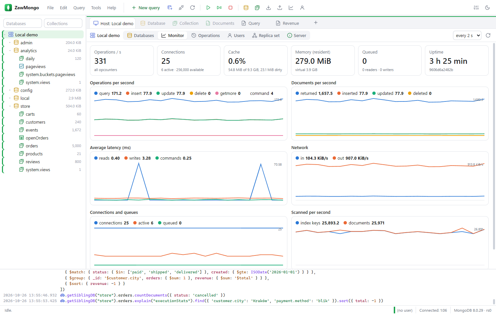

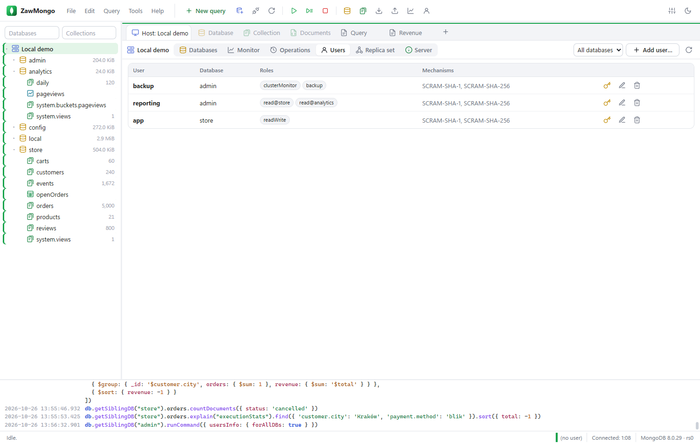

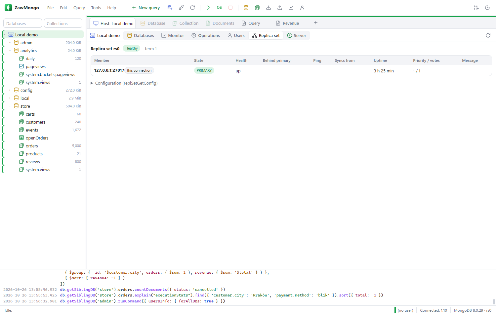

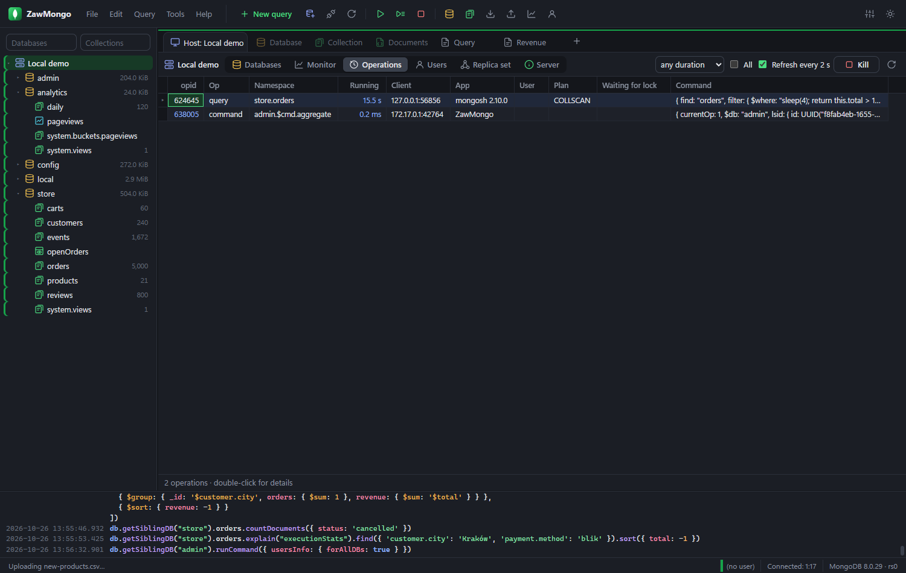

Importing a semicolon-separated CSV file with a preview of the typed documents:

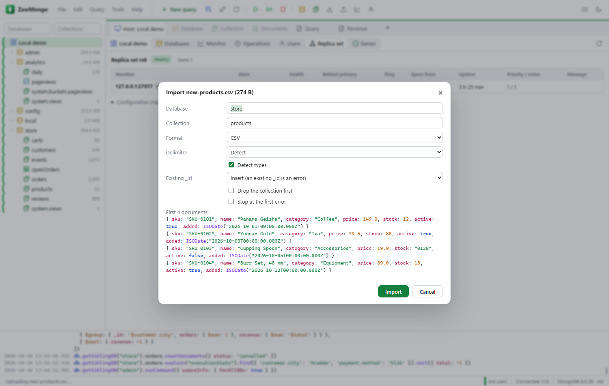

## Requirements

- MongoDB 4.4 or later. Tested against MongoDB 8.0 (standalone and a single-node replica set); CI also runs the integration tests on 7.0. Sharded clusters (through mongos) and Atlas use the same driver paths but haven't been tested yet.
- To build: the [.NET 10 SDK](https://dotnet.microsoft.com/download).
- On Linux the native window needs WebKitGTK 4.1 and libnotify (`libwebkit2gtk-4.1-0` and `libnotify4` on Debian and Ubuntu); without them ZawMongo uses a browser window.

## Running

```
run.bat                          # Windows: build and start
dotnet run --project src/ZawMongo
```

Options:

```
--port <n>        Listen on this local port (default: a random free port)
--no-browser      Don't open a window; print the URL instead (implies --keep-alive)
--use-browser     Use a browser app window instead of the native window
--keep-alive      Keep running after the last browser window is closed
--browser <path>  Chromium-based browser for the app window (implies --use-browser)
--config <dir>    Configuration directory (saved sessions, UI state)
--token <value>   Use a fixed API token instead of a random one (for automation and tests)
```

The backend listens on the loopback interface only, and every API call must carry a per-process token, so other local web pages can't drive it. Saved sessions, saved queries and the UI state live in the configuration directory (`%APPDATA%\ZawMongo`, `~/.config/ZawMongo`), readable by the current user only.

## Building a release

```
./publish.ps1                    # or ./publish.sh — single-file executables in dist/<rid>
./publish.ps1 -Runtimes win-x64 -Version 1.2.0
```

A `vX.Y.Z` tag builds every platform in CI, signs the Windows executable (when Azure Artifact Signing is configured) and publishes a GitHub release with `SHA256SUMS`, which the self-updater requires.

## Tests

```
dotnet test                                            # unit tests; integration tests are skipped
ZAWMONGO_TEST_URI="mongodb://127.0.0.1:27017/?directConnection=true" dotnet test   # with a server
cd tests/js && npm test                                # UI modules (Node 22+)
```

A throwaway server for the integration tests: `docker run -d -p 127.0.0.1:27017:27017 mongo:8.0`. Each test class works in its own `zawmongo_test_*` database and drops it afterwards.

## Project layout

```
src/ZawMongo/            backend (ASP.NET Core) and the embedded UI (wwwroot)
  Shell.cs               mongosh-style statement splitter and parser (literal arguments only)
  ShellRunner.cs         runs parsed statements through the driver
  ReadOnlyGuard.cs       what read-only sessions may run
  Browse.cs              databases, collections, find with counts, document edits
  Schema.cs              schema analysis of sampled documents
  Server.cs              server status, monitor samples, operations, users, replica set
  Transfer.cs            JSON / NDJSON / CSV import and export
  wwwroot/js/            UI: app, tree, document views, editor, explain, views/*
tests/ZawMongo.Tests/    xUnit unit and integration tests
tests/js/                node:test suites for the UI modules
assets/icon/             icon source (SVG) and build-icons.ps1 (PNGs and the Windows .ico)
```
